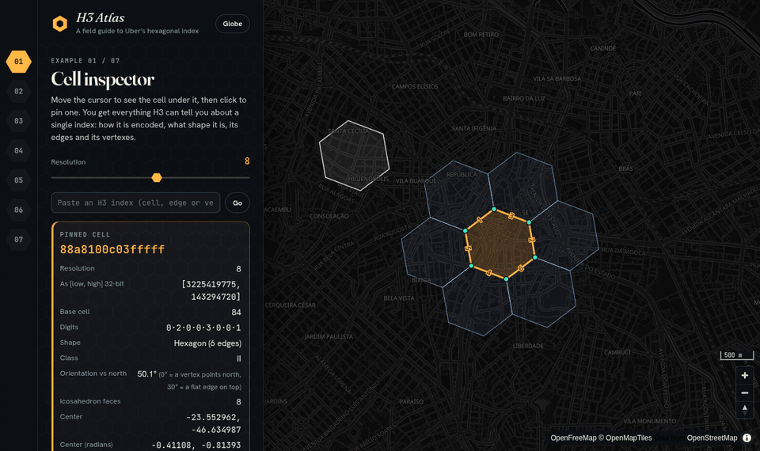

# H3 Atlas

An interactive field guide to [H3](https://h3geo.org), Uber's hexagonal hierarchical geospatial index, rendered with [MapLibre GL](https://maplibre.org) on OpenStreetMap data.

Seven small examples together use **every function exported by `h3-js` 4.5**. Each example's panel lists the calls it makes, so the app also works as an API reference.



## Examples

| # | Example | What it shows | Main APIs |
|---|---------|---------------|-----------|
| 01 | **Cell inspector** | Hover or click a cell to see its encoding (base cell + digits), shape, class, faces, rotation relative to north, area, directed edges and vertexes. You can paste any index (cell, edge or vertex) to jump to it, or build a cell from its parts. | `latLngToCell`, `getIndexDigit`, `originToDirectedEdges`, `cellToVertexes`, `constructCell`, `isValid*`, `h3IndexToSplitLong` |
| 02 | **Viewport grid** | Fills the visible map with cells. Each cell is colored by its position among its 7 siblings, which shows how every parent splits into 7 children. The resolution can follow the zoom level. | `polygonToCells`, `cellToChildPos`, `getNumCells` |
| 03 | **Parents & children** | The full parent chain, children and grandchildren, the center child, a slider that walks the children by position, and a table of all 16 resolutions. | `cellToParent`, `cellToChildren`, `cellToCenterChild`, `childPosToCell` |
| 04 | **Neighbors & paths** | k-disks colored by distance, rings, grid paths with local IJ coordinates, and grid distance compared with great-circle distance. `gridRingUnsafe` is shown failing next to a pentagon. | `gridDisk`, `gridDiskDistances`, `gridRing`, `gridPathCells`, `cellToLocalIj` |
| 05 | **Polygon to cells** | Draw a polygon (holes are supported), compare the four containment modes, then compact the result into mixed-resolution cells and outline it. | `polygonToCellsExperimental`, `compactCells`, `uncompactCells`, `cellsToMultiPolygon` |
| 06 | **The whole planet** | On a globe: the 122 base cells and 12 pentagons, colored by base cell, icosahedron face or class II/III. | `getRes0Cells`, `getPentagons`, `getIcosahedronFaces` |
| 07 | **Hexbin: earthquakes** | The last 30 days of USGS earthquakes grouped into cells, colored by count or largest magnitude, shown flat or as 3D columns. Click a cell to list its quakes. | `latLngToCell`, `cellArea` |

The URL hash selects an example (`/#polygon`, `/#hexbin`, …), so you can link to one directly.

## Getting started

Requires Node.js 22.18 or newer (tests use Node's built-in TypeScript support).

```bash
npm install
npm run dev       # http://localhost:5173
npm run build     # typecheck + production build into dist/
npm test          # unit tests for the geometry helpers (node:test)
```

You don't need API keys. The basemap comes from [OpenFreeMap](https://openfreemap.org) and the earthquake feed is public.

## Stack

- **TypeScript + Vite**, no UI framework
- **[maplibre-gl](https://github.com/maplibre/maplibre-gl-js)** 6 for rendering, including the globe projection
- **[h3-js](https://github.com/uber/h3-js)** 4.5

## Project layout

```
index.html              page shell: example rail, side panel, map
src/main.ts             map setup, switching between examples
src/mode.ts             Mode interface, map-layer bookkeeping, small UI helpers
src/h3geo.ts            H3 → GeoJSON helpers (antimeridian/pole handling, viewport cells, orientation)
src/h3geo.test.ts       tests for those helpers
src/modes/*.ts          one file per example
src/style.css           all styling
```

Each example implements one interface:

```ts
interface Mode {
  id: string;
  title: string;
  blurb: string;
  apis: string[];
  mount(map: Map, panel: HTMLElement): () => void; // returns cleanup
}
```

`mount` adds its sources, layers and listeners through a small `scene()` helper and returns a cleanup function that removes all of them. Switching examples calls the old cleanup, then the new `mount`.

## Things worth knowing if you reuse this code

- **Antimeridian and poles.** `cellToBoundary` returns longitudes in [-180, 180], so a cell that crosses 180° would be drawn across the whole map. `unwrapRing` keeps each vertex within 180° of the previous one. A ring that still wraps a full 360° must contain a pole, so it is closed through the pole instead.
- **Wide viewports.** H3 assumes a polygon wider than 180° crosses the antimeridian. When zoomed out, `viewportCells` splits the view into chunks at most 90° wide, and it refuses to fill the view if the estimated cell count is over a limit, so the tab doesn't freeze.
- **Cells aren't aligned to north.** Orientation depends on the icosahedron face, and odd resolutions (class III) are rotated about 19.1° from even ones. The inspector shows the angle for each cell.
- **Layer order.** H3 layers go under the basemap's *last* block of label layers, not the first label layer. The dark style has label layers early in its stack, and inserting there hides the cells under buildings.
- **Vite + MapLibre worker.** `vite.config.ts` excludes `maplibre-gl` from dependency pre-bundling. Otherwise the worker's relative URL breaks in dev.
- **Untrusted data.** Text from the USGS feed is escaped before it goes into the DOM, and only `earthquake.usgs.gov` links are rendered.

## Data and attribution

- Map data © [OpenStreetMap](https://www.openstreetmap.org/copyright) contributors, tiles by [OpenFreeMap](https://openfreemap.org) and [OpenMapTiles](https://openmaptiles.org).
- Earthquakes: [USGS Earthquake Hazards Program](https://earthquake.usgs.gov/earthquakes/feed/) (public domain), fetched live when the example opens.
- H3 is developed by Uber and released under the Apache 2.0 license.
